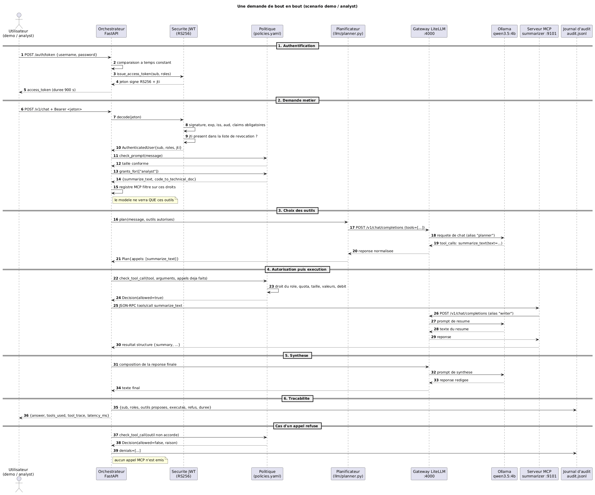
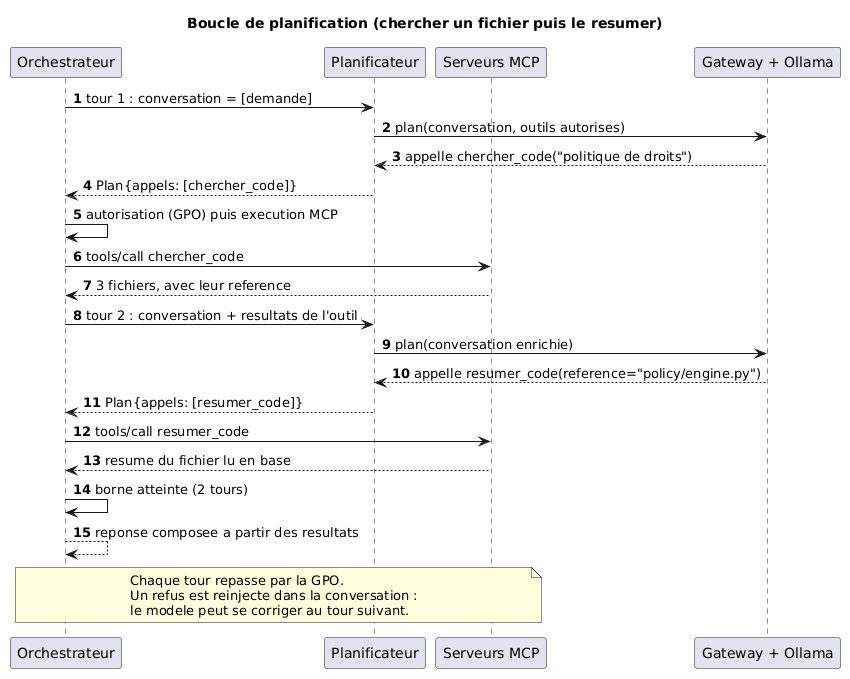

# Diagramme de sequence : une demande de bout en bout

Scenario : `demo` (role `analyst`) envoie "resume moi ce document".
C'est le diagramme de reference du projet : tout le reste decoule de ce trajet.

Source PlantUML : [01-sequence-demande.puml](01-sequence-demande.puml)

## La boucle de planification

Depuis l'ajout du serveur de code en base, l'orchestrateur ne se contente plus
d'un seul tour : il faut d'abord trouver le fichier, puis le lire pour le
resumer. Le modele est donc rappele avec les resultats du tour precedent.

Source PlantUML : [01b-boucle-planification.puml](01b-boucle-planification.puml)

Trois points a retenir :

- **la boucle est bornee** (`max_tool_rounds`, 2 par defaut). Sans borne, une
erreur de modelisation ferait tourner l'orchestrateur indefiniment ;
- **chaque tour repasse par la GPO**. Un droit retire au tour 1 le reste au tour
2 : l'autorisation n'est pas mise en cache ;
- **les refus sont reinjectes dans la conversation**. Le modele voit qu'un outil
a ete refuse, avec la raison, et peut se corriger au tour suivant. C'est aussi
ce qui permet de comprendre, dans les journaux, pourquoi il a change d'avis.

Le journal d'audit porte le champ `rounds` : une requete a trois tours signale
souvent une tache mal cadree ou un outil qui ne repond pas comme attendu.

## Ce que le diagramme met en evidence

**Trois appels au modele pour une seule demande.** Un pour choisir l'outil, un
dans l'outil pour produire le resultat, un pour rediger la reponse finale. C'est
le cout reel d'une architecture d'orchestration : chaque etape ajoute de la
latence. D'ou les deux leviers de reglage du projet :
`SYNTHESIS_ENABLED=false` supprime le troisieme appel, et l'attaque
d'entrainement du modele determine la qualite du premier.

**Le meme chemin pour tous les appels au modele.** L'orchestrateur et le serveur
MCP passent tous les deux par la gateway : une seule adresse, une seule cle, un
seul point de journalisation.

**La decision d'autorisation est prise deux fois.** Une fois avant de montrer les
outils au modele (etape 4 du diagramme, "le modele ne verra que ces outils"), une
fois avant d'executer chaque appel. Les deux verrous sont volontairement
redondants.

**Un appel refuse n'atteint jamais le serveur MCP.** Le refus se produit dans
l'orchestrateur, avant toute communication reseau vers l'outil. C'est ce qui
permet de garantir qu'un outil interdit n'est jamais execute, quelle que soit la
formulation du prompt.
