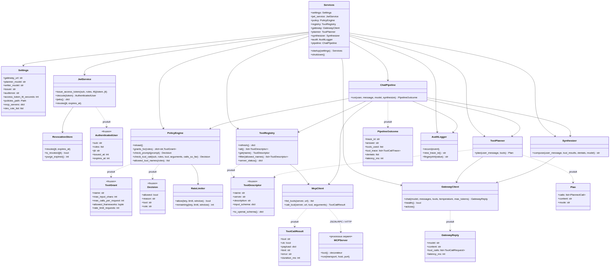

# Diagramme de classes

Vue des objets principaux et de leurs relations. Les noms correspondent
exactement aux modules du depot, ce qui permet de passer du diagramme au code
sans chercher.

```mermaid
classDiagram
    direction TB

    class Settings {
        +gateway_url: str
        +planner_model: str
        +writer_model: str
        +issuer: str
        +audience: str
        +access_token_ttl_seconds: int
        +policies_path: Path
        +mcp_servers: dict
        +dev_role_list: list
    }

    class Services {
        +settings: Settings
        +jwt_service: JwtService
        +policy: PolicyEngine
        +registry: ToolRegistry
        +gateway: GatewayClient
        +planner: ToolPlanner
        +synthesizer: Synthesizer
        +audit: AuditLogger
        +pipeline: ChatPipeline
        +startup(settings) Services
        +shutdown()
    }

    class JwtService {
        +issue_access_token(sub, roles, ttl) (token, jti)
        +decode(token) AuthenticatedUser
        +jwks() dict
        +revoke(jti, expires_at)
    }

    class RevocationStore {
        +revoke(jti, expires_at)
        +is_revoked(jti) bool
        +purge_expired() int
    }

    class AuthenticatedUser {
        <<frozen>>
        +sub: str
        +roles: list
        +jti: str
        +issued_at: int
        +expires_at: int
    }

    class PolicyEngine {
        +reload()
        +grants_for(roles) dict~str,ToolGrant~
        +check_prompt(prompt) Decision
        +check_tool_call(sub, roles, tool, arguments, calls_so_far) Decision
        +allowed_tool_names(roles) list
    }

    class ToolGrant {
        <<frozen>>
        +name: str
        +max_input_chars: int
        +max_calls_per_request: int
        +allowed_frameworks: tuple
        +rate_limit_requests: int
    }

    class Decision {
        <<frozen>>
        +allowed: bool
        +reason: str
        +tool: str
        +rule: str
    }

    class RateLimiter {
        +allow(key, limit, window) bool
        +remaining(key, limit, window) int
    }

    class ToolRegistry {
        +refresh() dict
        +all() list~ToolDescriptor~
        +get(name) ToolDescriptor
        +filter(allowed_names) list~ToolDescriptor~
        +server_status() dict
    }

    class ToolDescriptor {
        <<frozen>>
        +name: str
        +server: str
        +description: str
        +input_schema: dict
        +to_openai_schema() dict
    }

    class McpClient {
        +list_tools(server, url) list
        +call_tool(server, url, tool, arguments) ToolCallResult
    }

    class ToolCallResult {
        +tool: str
        +ok: bool
        +payload: dict
        +text: str
        +error: str
        +duration_ms: int
    }

    class GatewayClient {
        +chat(model, messages, tools, temperature, max_tokens) GatewayReply
        +health() bool
        +aclose()
    }

    class GatewayReply {
        +model: str
        +content: str
        +tool_calls: list~ToolCallRequest~
        +latency_ms: int
    }

    class ToolPlanner {
        +plan(user_message, tools) Plan
    }

    class Plan {
        +calls: list~PlannedCall~
        +content: str
        +mode: str
    }

    class Synthesizer {
        +compose(user_message, tool_results, denials, model) str
    }

    class ChatPipeline {
        +run(user, message, model, synthesize) PipelineOutcome
    }

    class PipelineOutcome {
        +trace_id: str
        +answer: str
        +tools_used: list
        +tool_trace: list~ToolCallTrace~
        +denials: list
        +latency_ms: int
    }

    class AuditLogger {
        +record(event)
        +new_trace_id() str
        +fingerprint(value) str
    }

    class MCPServer {
        <<processus separe>>
        +tool() decorateur
        +run(transport, host, port)
    }

    Services --> Settings
    Services --> JwtService
    Services --> PolicyEngine
    Services --> ToolRegistry
    Services --> GatewayClient
    Services --> ToolPlanner
    Services --> Synthesizer
    Services --> AuditLogger
    Services --> ChatPipeline

    JwtService --> RevocationStore
    JwtService ..> AuthenticatedUser : produit
    PolicyEngine --> RateLimiter
    PolicyEngine ..> ToolGrant : produit
    PolicyEngine ..> Decision : produit
    ToolRegistry --> McpClient
    ToolRegistry ..> ToolDescriptor : produit
    McpClient ..> ToolCallResult : produit
    GatewayClient ..> GatewayReply : produit
    ToolPlanner --> GatewayClient
    ToolPlanner ..> Plan : produit
    Synthesizer --> GatewayClient
    ChatPipeline --> PolicyEngine
    ChatPipeline --> ToolRegistry
    ChatPipeline --> McpClient
    ChatPipeline --> ToolPlanner
    ChatPipeline --> Synthesizer
    ChatPipeline --> AuditLogger
    ChatPipeline ..> PipelineOutcome : produit
    ToolPlanner ..> ToolDescriptor : consomme
    McpClient ..> MCPServer : JSON-RPC / HTTP
```

## Points de conception visibles sur le diagramme

**Les objets de decision sont immuables.** `AuthenticatedUser`, `ToolGrant`,
`Decision`, `ToolDescriptor` sont declares `frozen` (dataclasses gelees). Une
decision d'autorisation ne peut donc pas etre modifiee apres coup par du code
maladroit : il faut en produire une nouvelle.

**Le pipeline ne construit rien.** `ChatPipeline` recoit ses dependances deja
assemblees par `Services`. C'est ce qui rend le pipeline testable : dans
`orchestrator/tests/test_pipeline.py`, seuls `GatewayClient` et `McpClient` sont
remplaces, tout le reste est le code de production.

**Le modele n'apparait nulle part comme autorite.** `ToolPlanner` produit un
`Plan` (une proposition). Seul `PolicyEngine` produit des `Decision`. La
separation est physique : deux modules, deux responsabilites.

**Un serveur MCP est un processus separe.** Il n'est donc pas dans le meme
diagramme d'objets : c'est une frontiere reseau, materialisee par la fleche
`JSON-RPC / HTTP`.
