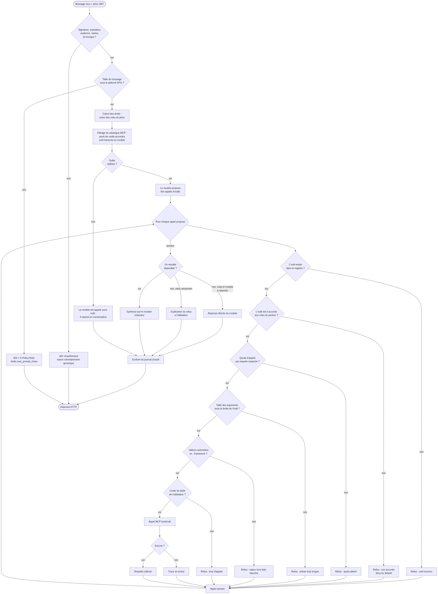
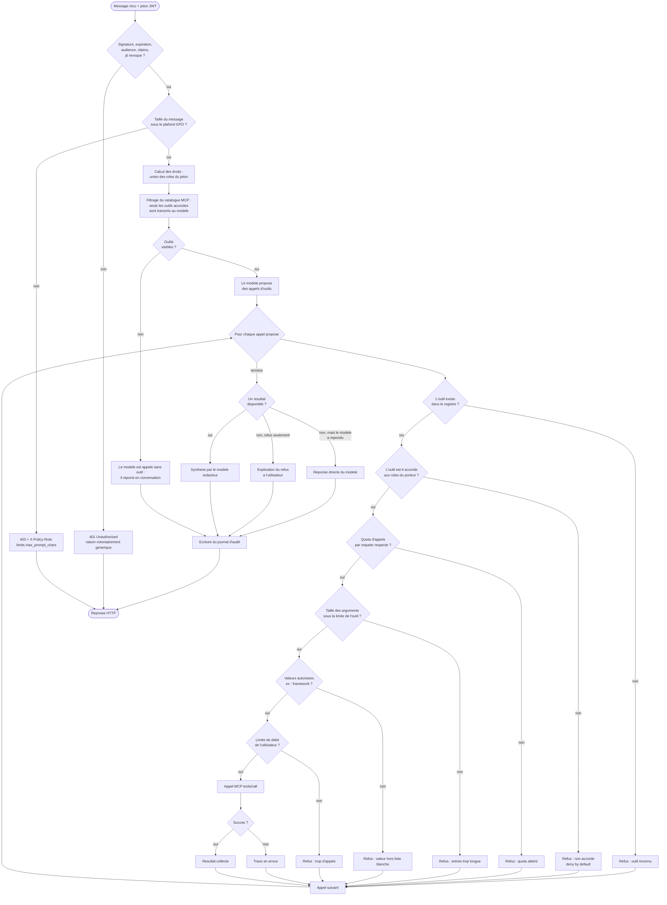

# Diagramme d'activite : choix et autorisation des outils

Ce diagramme repond a la question "que se passe-t-il exactement entre le moment
ou l'utilisateur envoie son message et le moment ou un outil est appele ?", avec
les points de refus.

## Deux idees a retenir de ce diagramme

**Les refus n'arretent pas la requete.** Chaque appel refuse est enregistre dans
`denials` et la boucle continue : l'utilisateur obtient une reponse exploitable
qui explique ce qui a ete refuse et pourquoi, au lieu d'une erreur opaque. En
revanche, la requete est refusee en bloc (403) si le message lui-meme viole un
plafond global : inutile de faire travailler le modele.

**Six portes avant l'execution, et une seule apres.** Les controles sont tous
places avant l'appel reseau. Rien n'est filtre "apres coup" : un outil interdit
n'est jamais execute, meme partiellement, meme pour "verifier".

**La sortie du modele n'est jamais une entree de confiance.** Elle est traitee
comme une proposition, exactement comme le serait une entree utilisateur.

## Ou toucher pour changer un comportement

| Comportement | Fichier a modifier |
| --- | --- |
| Ajouter ou retirer un droit | `config/policies.yaml` |
| Changer un plafond de taille ou de debit | `config/policies.yaml` (section `limits` ou par outil) |
| Ajouter un outil | nouveau dossier dans `mcp_servers/`, puis URL dans `.env` |
| Changer la maniere dont le modele choisit | `orchestrator/app/llm/planner.py` |
| Changer la redaction de la reponse finale | `orchestrator/app/llm/synthesizer.py` |
| Changer ce qui est trace | `orchestrator/app/audit.py` et les appels dans `pipeline.py` |
