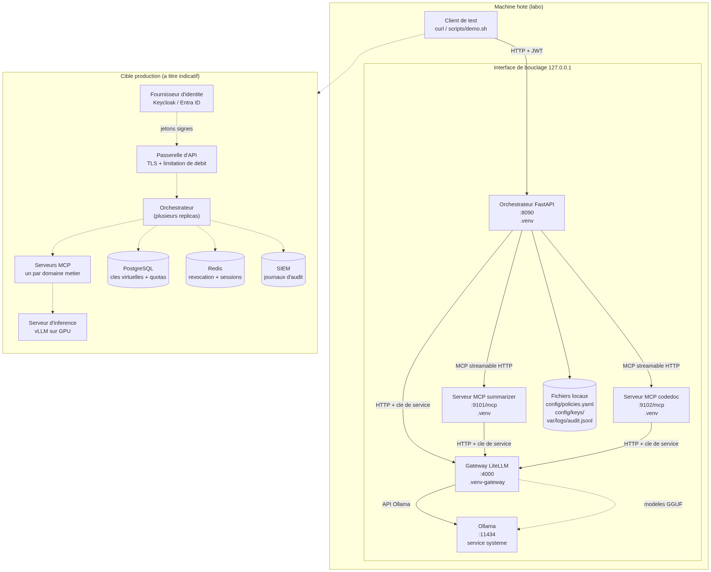
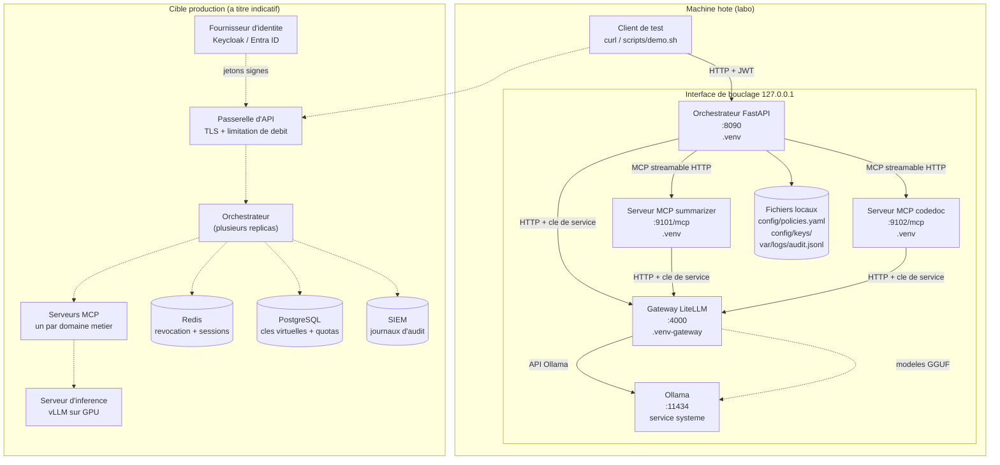

# Diagramme de deploiement

Etat du labo. Tout tourne sur une seule machine, sur l'interface de bouclage
(loopback) : les services ne sont pas joignables depuis le reseau.





## Trois frontieres de reseau, trois niveaux de confiance

| Zone | Confiance | Ce qui s'y trouve | Protection |
| --- | --- | --- | --- |
| Client | Non maitrisee | Poste de l'utilisateur, automatismes | Jeton JWT, limitation de debit |
| Applications | Maitrisee | Orchestrateur, serveurs MCP | Cle de service, reseau segmente |
| Moteur | Maitrisee | Gateway, serveur d'inference | Aucun acces depuis l'exterieur |

**Ce qui est faux aujourd'hui dans le labo, et qu'il faut corriger avant toute
mise en production :**

- tout est en HTTP sans TLS, y compris les jetons : a remplacer par HTTPS, et
  mTLS entre services internes ;
- la meme cle sert a tous les composants internes : a remplacer par une cle
  virtuelle par service, avec quotas et modeles autorises par cle (base
  PostgreSQL cote LiteLLM, voir `gateway/README.md`) ;
- la politique et les jetons reposent sur des fichiers locaux : a deplacer vers
  Redis et un service d'identite ;
- la limitation de debit est en memoire, donc non partagee entre replicas : a
  deplacer dans la passerelle d'API ;
- un seul exemplaire de chaque service : a passer en plusieurs replicas, en
  verifiant que rien n'est conserve en memoire entre requetes (c'est deja le cas
  pour les sessions MCP, ouvertes puis fermees a chaque appel).

## Ordre de demarrage et de dependance

```
Ollama  ->  Gateway LiteLLM  ->  Serveurs MCP  ->  Orchestrateur
```

L'orchestrateur interroge les serveurs MCP au demarrage (`ToolRegistry.refresh`)
mais ne refuse pas de demarrer si l'un est absent : il le marque
indisponible et retire ses outils du catalogue. C'est un choix de disponibilite,
visible dans la reponse de `GET /health`.

Consequence pratique a connaitre : si vous lancez un serveur MCP **apres**
l'orchestrateur, ses outils n'apparaitront pas tant que l'orchestrateur n'aura
pas redemarre.
